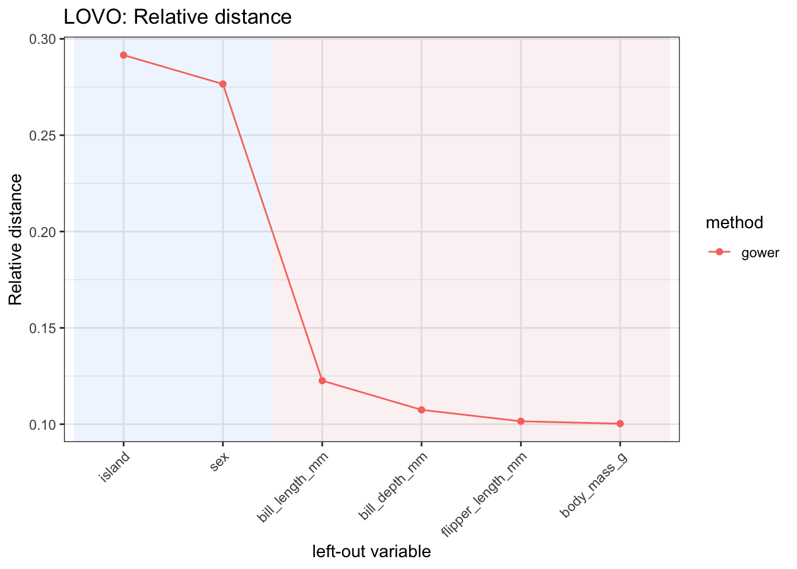

# manydist: distance-based learning with mixed-type data

## 1 Overview

`manydist` provides tools for constructing dissimilarities for
numerical, categorical, and mixed-type data.

The main function is
[`mdist()`](https://alfonsoiodicede.github.io/manydist_package/reference/mdist.md).
It computes a dissimilarity object that can be used in distance-based
learning workflows, including clustering, nearest-neighbour prediction,
and diagnostic analyses.

The package supports both preset specifications and custom
specifications. In the current interface:

- `method_cat` controls the categorical dissimilarity;
- `method_num` controls the preprocessing of numerical variables;
- `commensurable` controls whether variable-wise contributions are
  placed on a comparable scale;
- `preset` selects a predefined distance specification.

Numerical variables are compared through Manhattan-type contributions to
preserve additivity. The exceptions are presets such as `"hl"` and
`"euclidean"`, where the Euclidean structure is part of the definition.

The `"euclidean"` preset can be applied to mixed datasets to: it
computes Euclidean distances on standardized variables after one-hot
encoding categorical variables.

## 2 Setup

``` r

library(manydist)
library(dplyr)
library(tidyr)
library(recipes)
```

We use the `palmerpenguins` data for illustration.

``` r

if (requireNamespace("palmerpenguins", quietly = TRUE)) {
  data("penguins", package = "palmerpenguins")

  penguins_small <- palmerpenguins::penguins |>
    dplyr::select(
      species,
      bill_length_mm,
      bill_depth_mm,
      flipper_length_mm,
      body_mass_g,
      island,
      sex
    ) |>
    tidyr::drop_na()
}
```

The data contain numerical variables, such as bill length and body mass,
and categorical variables, such as island and sex.

``` r

dplyr::glimpse(penguins_small)
```

    Rows: 333
    Columns: 7
    $ species           <fct> Adelie, Adelie, Adelie, Adelie, Adelie, Adelie, Adel…
    $ bill_length_mm    <dbl> 39.1, 39.5, 40.3, 36.7, 39.3, 38.9, 39.2, 41.1, 38.6…
    $ bill_depth_mm     <dbl> 18.7, 17.4, 18.0, 19.3, 20.6, 17.8, 19.6, 17.6, 21.2…
    $ flipper_length_mm <int> 181, 186, 195, 193, 190, 181, 195, 182, 191, 198, 18…
    $ body_mass_g       <int> 3750, 3800, 3250, 3450, 3650, 3625, 4675, 3200, 3800…
    $ island            <fct> Torgersen, Torgersen, Torgersen, Torgersen, Torgerse…
    $ sex               <fct> male, female, female, female, male, female, male, fe…

## 3 Computing a mixed-type dissimilarity

The simplest way to compute a mixed-type dissimilarity is to use a
preset.

For example, the `"gower"` preset computes a Gower-type dissimilarity
for mixed numerical and categorical data.

``` r

d_gower <- mdist(
  penguins_small |> dplyr::select(-species),
  preset = "gower"
)

d_gower
```

    MDist object
      preset : gower
      number of observations : 333
      number of continuous variables   : 4
      number of categorical variables   : 2
      parameters:
        - commensurability adjustment: FALSE

The resulting object stores the dissimilarity matrix and metadata about
the distance specification.

``` r

class(d_gower)
```

    [1] "MDist" "R6"   

The distance matrix can be extracted with `to_dist()`.

``` r

as.matrix(d_gower$to_dist())[1:5, 1:5]
```

               1          2          3          4          5
    1 0.00000000 0.21132367 0.25052445 0.24090408 0.06896389
    2 0.21132367 0.00000000 0.06763994 0.09064582 0.24961473
    3 0.25052445 0.06763994 0.00000000 0.06252081 0.25695739
    4 0.24090408 0.09064582 0.06252081 0.00000000 0.22595173
    5 0.06896389 0.24961473 0.25695739 0.22595173 0.00000000

## 4 Response-aware dissimilarities

Some categorical dissimilarities can use a response variable. When a
response is supplied to
[`mdist()`](https://alfonsoiodicede.github.io/manydist_package/reference/mdist.md),
it is used for response-aware distance construction and is removed from
the predictors.

Therefore, in the following example, `species` is used as the response
and is not also treated as a predictor.

``` r

d_response <- mdist(
  penguins_small,
  response = species,
  preset = "u_dep"
)

d_response
```

    MDist object
      preset : u_dep
      number of observations : 333
      number of continuous variables   : 4
      number of categorical variables   : 2
      parameters:
        - categorical method: tvd
        - numerical preprocessing: pc_scores
        - commensurability adjustment: TRUE

The same can be written by passing the response as a character string.

``` r

d_response_chr <- mdist(
  penguins_small,
  response = "species",
  preset = "u_dep"
)

d_response_chr
```

    MDist object
      preset : u_dep
      number of observations : 333
      number of continuous variables   : 4
      number of categorical variables   : 2
      parameters:
        - categorical method: tvd
        - numerical preprocessing: pc_scores
        - commensurability adjustment: TRUE

## 5 Custom distance specifications

Presets are convenient, but users can also define custom specifications.

In a custom specification, `method_cat` controls the categorical
dissimilarity and `method_num` controls the preprocessing applied to
numerical variables.

``` r

d_custom <- mdist(
  penguins_small |> dplyr::select(-species),
  preset = "custom",
  method_cat = "matching",
  method_num = "std",
  commensurable = TRUE
)

d_custom
```

    MDist object
      preset : custom
      number of observations : 333
      number of continuous variables   : 4
      number of categorical variables   : 2
      parameters:
        - categorical method: matching
        - numerical preprocessing: std
        - commensurability adjustment: TRUE
        - number of principal components: 6
        - inertia threshold: NULL

Here, categorical variables are compared using matching dissimilarities,
numerical variables are standardized, and variable-wise contributions
are made commensurable.

A response-aware custom specification can also be used.

``` r

d_custom_response <- mdist(
  penguins_small,
  response = species,
  preset = "custom",
  method_cat = "tvd",
  method_num = "std",
  commensurable = TRUE
)

d_custom_response
```

    MDist object
      preset : custom
      number of observations : 333
      number of continuous variables   : 4
      number of categorical variables   : 2
      parameters:
        - categorical method: tvd
        - numerical preprocessing: std
        - commensurability adjustment: TRUE
        - number of principal components: 6
        - inertia threshold: NULL

If only one categorical predictor is available, methods that require
more than one categorical variable may switch to a simpler alternative
internally.

## 6 Euclidean preset

The `"euclidean"` preset computes Euclidean distances after converting
categorical variables to one-hot dummy variables.

``` r

d_euclidean <- mdist(
  penguins_small |> dplyr::select(-species),
  preset = "euclidean"
)

d_euclidean
```

    MDist object
      preset : euclidean
      number of observations : 333
      number of continuous variables   : 4
      number of categorical variables   : 2
      parameters:
        - numerical preprocessing: std

This preset replaces the former `"euclidean_onehot"` name.

## 7 Comparing presets

Different presets encode different assumptions about how numerical and
categorical variables should contribute to the final dissimilarity.

``` r

d_u_indep <- mdist(
  penguins_small |> dplyr::select(-species),
  preset = "u_indep"
)

d_u_mix <- mdist(
  penguins_small |> dplyr::select(-species),
  preset = "u_mix"
)

d_hl <- mdist(
  penguins_small |> dplyr::select(-species),
  preset = "hl"
)

d_u_indep
```

    MDist object
      preset : u_indep
      number of observations : 333
      number of continuous variables   : 4
      number of categorical variables   : 2
      parameters:
        - categorical method: matching
        - numerical preprocessing: std
        - commensurability adjustment: TRUE

``` r

d_u_mix
```

    MDist object
      preset : u_mix
      number of observations : 333
      number of continuous variables   : 4
      number of categorical variables   : 2
      parameters:
        - categorical method: tvd
        - numerical preprocessing: std
        - commensurability adjustment: TRUE

``` r

d_hl
```

    MDist object
      preset : hl
      number of observations : 333
      number of continuous variables   : 4
      number of categorical variables   : 2
      parameters:
        - categorical method: HLeucl
        - numerical preprocessing: std
        - commensurability adjustment: FALSE

The available presets include:

``` r

c(
  "custom",
  "gower",
  "euclidean",
  "unbiased_dependent",
  "u_dep",
  "u_dep_bw",
  "u_indep",
  "u_mix",
  "hl",
  "gudmm",
  "dkss",
  "mod_gower"
)
```

     [1] "custom"             "gower"              "euclidean"
     [4] "unbiased_dependent" "u_dep"              "u_dep_bw"
     [7] "u_indep"            "u_mix"              "hl"
    [10] "gudmm"              "dkss"               "mod_gower"         

Some presets are intended mainly for train-train dissimilarities and may
not support distances from new observations to training observations.

## 8 Distances from new observations to training observations

[`mdist()`](https://alfonsoiodicede.github.io/manydist_package/reference/mdist.md)
can also compute distances from new observations to the training
observations through the `new_data` argument.

``` r

set.seed(123)

split_id <- sample(seq_len(nrow(penguins_small)), size = floor(0.75 * nrow(penguins_small)))

penguins_train <- penguins_small[split_id, ]
penguins_test  <- penguins_small[-split_id, ]

d_new <- mdist(
  x = penguins_train |> dplyr::select(-species),
  new_data = penguins_test |> dplyr::select(-species),
  preset = "gower"
)

d_new
```

    MDist object
      preset : gower
      number of training observations : 249
      number of test observations     : 84
      number of continuous variables   : 4
      number of categorical variables   : 2
      parameters:
        - commensurability adjustment: FALSE

The resulting dissimilarity is rectangular: rows correspond to test
observations and columns correspond to training observations.

``` r

dim(as.matrix(d_new$distance))
```

    [1]  84 249

## 9 Using `manydist` in recipe workflows

The function
[`step_mdist()`](https://alfonsoiodicede.github.io/manydist_package/reference/step_mdist.md)
provides a recipe interface to
[`mdist()`](https://alfonsoiodicede.github.io/manydist_package/reference/mdist.md).
It replaces selected predictors with a distance-based representation.

In supervised workflows, the response is defined on the left-hand side
of the recipe formula. Selecting
[`recipes::all_predictors()`](https://recipes.tidymodels.org/reference/has_role.html)
therefore keeps the response out of the predictor set. For
non-response-aware specifications such as Gower distance, the response
is not used in the distance computation.

For response-aware presets such as `u_dep` and `u_mix`, and for
response-aware custom categorical methods,
[`step_mdist()`](https://alfonsoiodicede.github.io/manydist_package/reference/step_mdist.md)
automatically obtains the single outcome from the recipe. During
resampling, only outcomes from the current analysis set are used to fit
the distance preprocessor. Assessment and test outcomes are never
required or used. Set `response_used = FALSE` to construct the
corresponding predictor-only distance.

``` r

rec <- recipes::recipe(species ~ ., data = penguins_small) |>
  step_mdist(
    recipes::all_predictors(),
    preset = "gower",
    output = "distance_to_training"
  )

rec_prep <- recipes::prep(rec, training = penguins_small)

baked <- recipes::bake(rec_prep, new_data = penguins_small)

baked |>
  dplyr::slice_head(n = 5)
```

    # A tibble: 5 × 334
      species dist_1 dist_2 dist_3 dist_4 dist_5 dist_6 dist_7 dist_8 dist_9 dist_10
      <fct>    <dbl>  <dbl>  <dbl>  <dbl>  <dbl>  <dbl>  <dbl>  <dbl>  <dbl>   <dbl>
    1 Adelie  0      0.211  0.251  0.241  0.0690 0.192  0.101  0.229  0.0832  0.153
    2 Adelie  0.211  0      0.0676 0.0906 0.250  0.0338 0.278  0.0527 0.262   0.331
    3 Adelie  0.251  0.0676 0      0.0625 0.257  0.0694 0.271  0.0518 0.277   0.324
    4 Adelie  0.241  0.0906 0.0625 0      0.226  0.0851 0.250  0.103  0.238   0.273
    5 Adelie  0.0690 0.250  0.257  0.226  0      0.251  0.0820 0.281  0.0259  0.0957
    # ℹ 323 more variables: dist_11 <dbl>, dist_12 <dbl>, dist_13 <dbl>,
    #   dist_14 <dbl>, dist_15 <dbl>, dist_16 <dbl>, dist_17 <dbl>, dist_18 <dbl>,
    #   dist_19 <dbl>, dist_20 <dbl>, dist_21 <dbl>, dist_22 <dbl>, dist_23 <dbl>,
    #   dist_24 <dbl>, dist_25 <dbl>, dist_26 <dbl>, dist_27 <dbl>, dist_28 <dbl>,
    #   dist_29 <dbl>, dist_30 <dbl>, dist_31 <dbl>, dist_32 <dbl>, dist_33 <dbl>,
    #   dist_34 <dbl>, dist_35 <dbl>, dist_36 <dbl>, dist_37 <dbl>, dist_38 <dbl>,
    #   dist_39 <dbl>, dist_40 <dbl>, dist_41 <dbl>, dist_42 <dbl>, …

The resulting data contain the outcome variable, `species`, together
with one distance column for each training observation. These columns
are named `dist_1`, `dist_2`, and so on.

## 10 Custom specifications in recipes

The same interface can be used with a custom distance specification.

``` r

rec_custom <- recipes::recipe(species ~ ., data = penguins_small) |>
  step_mdist(
    recipes::all_predictors(),
    preset = "custom",
    method_cat = "matching",
    method_num = "std",
    commensurable = TRUE,
    output = "distance_to_training"
  )

rec_custom_prep <- recipes::prep(rec_custom, training = penguins_small)

baked_custom <- recipes::bake(rec_custom_prep, new_data = penguins_small)

baked_custom |>
  dplyr::slice_head(n = 5)
```

    # A tibble: 5 × 334
      species dist_1 dist_2 dist_3 dist_4 dist_5 dist_6 dist_7 dist_8 dist_9 dist_10
      <fct>    <dbl>  <dbl>  <dbl>  <dbl>  <dbl>  <dbl>  <dbl>  <dbl>  <dbl>   <dbl>
    1 Adelie    0      3.01   3.93   3.73   1.55  2.57    2.31   3.47  1.87     3.56
    2 Adelie    3.01   0      1.56   2.11   3.87  0.779   4.55   1.25  4.14     5.84
    3 Adelie    3.93   1.56   0      1.50   4.07  1.60    4.45   1.18  4.55     5.73
    4 Adelie    3.73   2.11   1.50   0      3.40  1.96    4.00   2.42  3.66     4.49
    5 Adelie    1.55   3.87   4.07   3.40   0     3.90    1.90   4.61  0.605    2.30
    # ℹ 323 more variables: dist_11 <dbl>, dist_12 <dbl>, dist_13 <dbl>,
    #   dist_14 <dbl>, dist_15 <dbl>, dist_16 <dbl>, dist_17 <dbl>, dist_18 <dbl>,
    #   dist_19 <dbl>, dist_20 <dbl>, dist_21 <dbl>, dist_22 <dbl>, dist_23 <dbl>,
    #   dist_24 <dbl>, dist_25 <dbl>, dist_26 <dbl>, dist_27 <dbl>, dist_28 <dbl>,
    #   dist_29 <dbl>, dist_30 <dbl>, dist_31 <dbl>, dist_32 <dbl>, dist_33 <dbl>,
    #   dist_34 <dbl>, dist_35 <dbl>, dist_36 <dbl>, dist_37 <dbl>, dist_38 <dbl>,
    #   dist_39 <dbl>, dist_40 <dbl>, dist_41 <dbl>, dist_42 <dbl>, …

In this example, `method_cat = "matching"` specifies the categorical
dissimilarity, while `method_num = "std"` specifies standardization of
numerical variables.

## 11 Pairwise dissimilarities in recipes

For distance-based clustering workflows,
[`step_mdist()`](https://alfonsoiodicede.github.io/manydist_package/reference/step_mdist.md)
can return the within-training pairwise dissimilarity matrix by setting
`output = "pairwise"`.

In this case, the recipe is intended for training-only workflows.

``` r

penguins_predictors <- penguins_small |>
  dplyr::select(-species)

rec_pairwise <- recipes::recipe(~ ., data = penguins_predictors) |>
  step_mdist(
    recipes::all_predictors(),
    preset = "gower",
    output = "pairwise"
  )

rec_pairwise_prep <- recipes::prep(rec_pairwise, training = penguins_predictors)

pairwise_dist <- recipes::bake(
  rec_pairwise_prep,
  new_data = penguins_predictors
)

pairwise_dist |>
  dplyr::slice_head(n = 5)
```

    # A tibble: 5 × 333
      dist_1 dist_2 dist_3 dist_4 dist_5 dist_6 dist_7 dist_8 dist_9 dist_10 dist_11
       <dbl>  <dbl>  <dbl>  <dbl>  <dbl>  <dbl>  <dbl>  <dbl>  <dbl>   <dbl>   <dbl>
    1 0      0.211  0.251  0.241  0.0690 0.192  0.101  0.229  0.0832  0.153   0.213
    2 0.211  0      0.0676 0.0906 0.250  0.0338 0.278  0.0527 0.262   0.331   0.0330
    3 0.251  0.0676 0      0.0625 0.257  0.0694 0.271  0.0518 0.277   0.324   0.0755
    4 0.241  0.0906 0.0625 0      0.226  0.0851 0.250  0.103  0.238   0.273   0.0645
    5 0.0690 0.250  0.257  0.226  0      0.251  0.0820 0.281  0.0259  0.0957  0.255
    # ℹ 322 more variables: dist_12 <dbl>, dist_13 <dbl>, dist_14 <dbl>,
    #   dist_15 <dbl>, dist_16 <dbl>, dist_17 <dbl>, dist_18 <dbl>, dist_19 <dbl>,
    #   dist_20 <dbl>, dist_21 <dbl>, dist_22 <dbl>, dist_23 <dbl>, dist_24 <dbl>,
    #   dist_25 <dbl>, dist_26 <dbl>, dist_27 <dbl>, dist_28 <dbl>, dist_29 <dbl>,
    #   dist_30 <dbl>, dist_31 <dbl>, dist_32 <dbl>, dist_33 <dbl>, dist_34 <dbl>,
    #   dist_35 <dbl>, dist_36 <dbl>, dist_37 <dbl>, dist_38 <dbl>, dist_39 <dbl>,
    #   dist_40 <dbl>, dist_41 <dbl>, dist_42 <dbl>, dist_43 <dbl>, …

## 12 Euclidean distances in recipes

The `"euclidean"` preset can also be used inside a recipe. Categorical
predictors are one-hot encoded internally before the Euclidean distance
is computed.

``` r

rec_euclidean <- recipes::recipe(species ~ ., data = penguins_small) |>
  step_mdist(
    recipes::all_predictors(),
    preset = "euclidean",
    output = "distance_to_training"
  )

rec_euclidean_prep <- recipes::prep(rec_euclidean, training = penguins_small)

baked_euclidean <- recipes::bake(rec_euclidean_prep, new_data = penguins_small)

baked_euclidean |>
  dplyr::slice_head(n = 5)
```

    # A tibble: 5 × 334
      species dist_1 dist_2 dist_3 dist_4 dist_5 dist_6 dist_7 dist_8 dist_9 dist_10
      <fct>    <dbl>  <dbl>  <dbl>  <dbl>  <dbl>  <dbl>  <dbl>  <dbl>  <dbl>   <dbl>
    1 Adelie    0     2.92   3.09   3.02    1.17  2.87    1.59  2.98   1.46     2.07
    2 Adelie    2.92  0      0.997  1.28    3.28  0.477   3.29  0.856  3.44     3.69
    3 Adelie    3.09  0.997  0      0.975   3.18  1.14    3.44  0.963  3.36     3.69
    4 Adelie    3.02  1.28   0.975  0       2.96  1.23    3.25  1.45   3.04     3.24
    5 Adelie    1.17  3.28   3.18   2.96    0     3.23    1.42  3.32   0.386    1.41
    # ℹ 323 more variables: dist_11 <dbl>, dist_12 <dbl>, dist_13 <dbl>,
    #   dist_14 <dbl>, dist_15 <dbl>, dist_16 <dbl>, dist_17 <dbl>, dist_18 <dbl>,
    #   dist_19 <dbl>, dist_20 <dbl>, dist_21 <dbl>, dist_22 <dbl>, dist_23 <dbl>,
    #   dist_24 <dbl>, dist_25 <dbl>, dist_26 <dbl>, dist_27 <dbl>, dist_28 <dbl>,
    #   dist_29 <dbl>, dist_30 <dbl>, dist_31 <dbl>, dist_32 <dbl>, dist_33 <dbl>,
    #   dist_34 <dbl>, dist_35 <dbl>, dist_36 <dbl>, dist_37 <dbl>, dist_38 <dbl>,
    #   dist_39 <dbl>, dist_40 <dbl>, dist_41 <dbl>, dist_42 <dbl>, …

## 13 Distance-based nearest-neighbour prediction

The distance representation produced by
[`step_mdist()`](https://alfonsoiodicede.github.io/manydist_package/reference/step_mdist.md)
can be used in downstream supervised learning workflows.

Here we illustrate a nearest-neighbour classifier using the
distance-to-training representation. The recipe first converts the
original mixed-type predictors into distances from each observation to
the training observations. The model is then tuned over the number of
neighbours.

``` r

library(tidymodels)

set.seed(123)

penguin_split <- rsample::initial_split(
  penguins_small,
  prop = 0.75,
  strata = species
)

penguin_train <- rsample::training(penguin_split)
penguin_test  <- rsample::testing(penguin_split)

set.seed(123)

penguin_folds <- rsample::vfold_cv(
  penguin_train,
  v = 5,
  strata = species
)
```

``` r

rec_knn <- recipes::recipe(species ~ ., data = penguin_train) |>
  step_mdist(
    recipes::all_predictors(),
    preset = "gower",
    output = "distance_to_training"
  )
```

``` r

knn_spec <- nearest_neighbor_dist(
  neighbors = tune::tune()
) |>
  parsnip::set_mode("classification")
```

``` r

knn_wf <- workflows::workflow() |>
  workflows::add_recipe(rec_knn) |>
  workflows::add_model(knn_spec)

knn_grid <- tibble::tibble(
  neighbors = c(1, 3, 5, 7, 9)
)

set.seed(123)

knn_res <- tune::tune_grid(
  knn_wf,
  resamples = penguin_folds,
  grid = knn_grid,
  metrics = yardstick::metric_set(accuracy)
)

knn_res |>
  tune::collect_metrics()
```

    # A tibble: 5 × 7
      neighbors .metric  .estimator  mean     n std_err .config
          <dbl> <chr>    <chr>      <dbl> <int>   <dbl> <chr>
    1         1 accuracy multiclass 0.996     5 0.00392 pre0_mod1_post0
    2         3 accuracy multiclass 1         5 0       pre0_mod2_post0
    3         5 accuracy multiclass 0.992     5 0.00485 pre0_mod3_post0
    4         7 accuracy multiclass 0.992     5 0.00485 pre0_mod4_post0
    5         9 accuracy multiclass 0.988     5 0.00798 pre0_mod5_post0

``` r

best_knn <- knn_res |>
  tune::select_best(metric = "accuracy")

best_knn
```

    # A tibble: 1 × 2
      neighbors .config
          <dbl> <chr>
    1         3 pre0_mod2_post0

``` r

final_knn_wf <- knn_wf |>
  tune::finalize_workflow(best_knn)

final_knn_fit <- final_knn_wf |>
  parsnip::fit(data = penguin_train)

knn_pred <- predict(final_knn_fit, new_data = penguin_test) |>
  dplyr::bind_cols(penguin_test |> dplyr::select(species))

yardstick::accuracy(knn_pred, truth = species, estimate = .pred_class)
```

    # A tibble: 1 × 3
      .metric  .estimator .estimate
      <chr>    <chr>          <dbl>
    1 accuracy multiclass     0.988

This example uses `preset = "gower"`, but the same workflow can be used
with any
[`mdist()`](https://alfonsoiodicede.github.io/manydist_package/reference/mdist.md)
preset or with a custom specification based on `method_cat`,
`method_num`, and `commensurable`.

## 14 Distance-based PAM clustering

The same dissimilarities can be used for clustering. For clustering
workflows,
[`step_mdist()`](https://alfonsoiodicede.github.io/manydist_package/reference/step_mdist.md)
can return the within-training pairwise dissimilarity matrix by setting
`output = "pairwise"`.

``` r

penguins_predictors <- penguins_small |>
  dplyr::select(-species)

rec_pam <- recipes::recipe(~ ., data = penguins_predictors) |>
  step_mdist(
    recipes::all_predictors(),
    preset = "gower",
    output = "pairwise"
  )
```

``` r

pam_spec <- pam_dist(
  num_clusters = 3
)

pam_fit <- generics::fit(
  pam_spec,
  recipe = rec_pam,
  data = penguins_predictors
)

pam_pred <- predict(pam_fit)

pam_pred |>
  dplyr::slice_head(n = 10)
```

    # A tibble: 10 × 1
       .pred_cluster
       <fct>
     1 1
     2 2
     3 2
     4 2
     5 1
     6 2
     7 1
     8 2
     9 1
    10 1            

Since the true species labels are available in this example, we can
inspect the relationship between the PAM clusters and the species
labels.

``` r

pam_pred |>
  dplyr::bind_cols(penguins_small |> dplyr::select(species)) |>
  dplyr::count(.pred_cluster, species)
```

    # A tibble: 6 × 3
      .pred_cluster species       n
      <fct>         <fct>     <int>
    1 1             Adelie       65
    2 1             Chinstrap    34
    3 2             Adelie       73
    4 2             Chinstrap    34
    5 3             Adelie        8
    6 3             Gentoo      119

## 15 Distance-based spectral clustering

Spectral clustering can be used in the same way, by combining a pairwise
distance recipe with the corresponding model specification.

``` r

rec_spectral <- recipes::recipe(~ ., data = penguins_predictors) |>
  step_mdist(
    recipes::all_predictors(),
    preset = "gower",
    output = "pairwise"
  )
```

``` r

spectral_spec <- spectral_dist(
  num_clusters = 3
)

spectral_fit <- generics::fit(
  spectral_spec,
  recipe = rec_spectral,
  data = penguins_predictors
)

spectral_pred <- predict(spectral_fit)

spectral_pred |>
  dplyr::slice_head(n = 10)
```

    # A tibble: 10 × 1
       .pred_cluster
       <fct>
     1 2
     2 1
     3 1
     4 1
     5 2
     6 1
     7 2
     8 1
     9 2
    10 2            

Again, because this is an illustrative labelled data set, we can compare
the resulting clusters with the observed species labels.

``` r

spectral_pred |>
  dplyr::bind_cols(penguins_small |> dplyr::select(species)) |>
  dplyr::count(.pred_cluster, species)
```

    # A tibble: 5 × 3
      .pred_cluster species       n
      <fct>         <fct>     <int>
    1 1             Adelie       73
    2 1             Chinstrap    34
    3 2             Adelie       73
    4 2             Chinstrap    34
    5 3             Gentoo      119

## 16 A small benchmark example

The function
[`benchmark_mdist()`](https://alfonsoiodicede.github.io/manydist_package/reference/benchmark_mdist.md)
applies
[`mdist()`](https://alfonsoiodicede.github.io/manydist_package/reference/mdist.md)
repeatedly over a grid of distance specifications and compares every
pair of successful results. This is useful for comparing alternative
presets and custom specifications systematically.

For a small example, we restrict the grid to a few specifications.

``` r

small_specs <- dplyr::bind_rows(
  all_dist_method_specs(preset = "all") |>
    dplyr::filter(preset %in% c("gower", "u_dep", "u_indep", "euclidean")),

  all_dist_method_specs(
    method_cat = c("matching", "tvd"),
    method_num = c("std", "robust"),
    commensurable = c(TRUE, FALSE)
  ) |>
    dplyr::filter(preset == "custom")
)

small_specs
```

    # A tibble: 10 × 4
       preset    method_cat method_num commensurable
       <chr>     <chr>      <chr>      <lgl>
     1 euclidean <NA>       <NA>       NA
     2 gower     <NA>       <NA>       NA
     3 u_dep     <NA>       <NA>       NA
     4 u_indep   <NA>       <NA>       NA
     5 custom    matching   robust     FALSE
     6 custom    matching   std        FALSE
     7 custom    matching   std        TRUE
     8 custom    tvd        robust     FALSE
     9 custom    tvd        std        FALSE
    10 custom    tvd        std        TRUE         

``` r

bench_small <- benchmark_mdist(
  penguins_small,
  response = species,
  specs = small_specs
)

bench_small |>
  dplyr::select(
    preset,
    method_cat,
    method_num,
    commensurable,
    ok,
    error
  )
```

    # A tibble: 10 × 6
       preset    method_cat method_num commensurable ok    error
       <chr>     <chr>      <chr>      <lgl>         <lgl> <chr>
     1 euclidean <NA>       <NA>       NA            TRUE  <NA>
     2 gower     <NA>       <NA>       NA            TRUE  <NA>
     3 u_dep     <NA>       <NA>       NA            TRUE  <NA>
     4 u_indep   <NA>       <NA>       NA            TRUE  <NA>
     5 custom    matching   robust     FALSE         TRUE  <NA>
     6 custom    matching   std        FALSE         TRUE  <NA>
     7 custom    matching   std        TRUE          TRUE  <NA>
     8 custom    tvd        robust     FALSE         TRUE  <NA>
     9 custom    tvd        std        FALSE         TRUE  <NA>
    10 custom    tvd        std        TRUE          TRUE  <NA> 

The `ok` column reports whether the distance computation completed
successfully. Failed specifications are kept in the output, with the
corresponding error message stored in `error`.

``` r

bench_small |>
  dplyr::count(ok)
```

    # A tibble: 1 × 2
      ok        n
      <lgl> <int>
    1 TRUE     10

When all specifications are successful, the resulting `MDist` objects
are stored in the `result` list-column and can be inspected or reused.

``` r

bench_small |>
  dplyr::filter(ok) |>
  dplyr::select(preset, method_cat, method_num, commensurable, result) |>
  dplyr::slice_head(n = 3)
```

    # A tibble: 3 × 5
      preset    method_cat method_num commensurable result
      <chr>     <chr>      <chr>      <lgl>         <list>
    1 euclidean <NA>       <NA>       NA            <MDist>
    2 gower     <NA>       <NA>       NA            <MDist>
    3 u_dep     <NA>       <NA>       NA            <MDist>

Pairwise MAD, relative distance, MDS congruence, and alienation are
available through [`summary()`](https://rdrr.io/r/base/summary.html).
Because `cluster_k` was left at its default of `NULL`, no clustering was
performed.

``` r

summary(bench_small) |>
  dplyr::select(
    method_1,
    method_2,
    mad,
    relative_distance,
    alienation
  ) |>
  dplyr::slice_head(n = 10)
```

    Summary of MDistBenchmark
      specifications : 10
      successful     : 10
      failed         : 0
      comparisons    : 45

    Pairwise diagnostics (upper triangle; diagonal omitted):

    mad:
                                          euclidean gower u_dep u_indep
    euclidean                                       3.638 2.076   2.074
    gower                                                 5.663   5.663
    u_dep                                                         1.266
    u_indep
    matching + robust (not commensurable)
    matching + std (not commensurable)
    matching + std (commensurable)
    tvd + robust (not commensurable)
    tvd + std (not commensurable)
    tvd + std (commensurable)
                                          matching + robust (not commensurable)
    euclidean                                                             0.585
    gower                                                                 3.613
    u_dep                                                                 2.163
    u_indep                                                               2.050
    matching + robust (not commensurable)
    matching + std (not commensurable)
    matching + std (commensurable)
    tvd + robust (not commensurable)
    tvd + std (not commensurable)
    tvd + std (commensurable)
                                          matching + std (not commensurable)
    euclidean                                                          1.855
    gower                                                              5.325
    u_dep                                                              1.555
    u_indep                                                            0.553
    matching + robust (not commensurable)                              1.712
    matching + std (not commensurable)
    matching + std (commensurable)
    tvd + robust (not commensurable)
    tvd + std (not commensurable)
    tvd + std (commensurable)
                                          matching + std (commensurable)
    euclidean                                                      2.074
    gower                                                          5.663
    u_dep                                                          1.266
    u_indep                                                        0.000
    matching + robust (not commensurable)                          2.050
    matching + std (not commensurable)                             0.553
    matching + std (commensurable)
    tvd + robust (not commensurable)
    tvd + std (not commensurable)
    tvd + std (commensurable)
                                          tvd + robust (not commensurable)
    euclidean                                                        0.780
    gower                                                            3.365
    u_dep                                                            2.447
    u_indep                                                          2.298
    matching + robust (not commensurable)                            0.490
    matching + std (not commensurable)                               1.961
    matching + std (commensurable)                                   2.298
    tvd + robust (not commensurable)
    tvd + std (not commensurable)
    tvd + std (commensurable)
                                          tvd + std (not commensurable)
    euclidean                                                     1.760
    gower                                                         5.077
    u_dep                                                         1.800
    u_indep                                                       0.976
    matching + robust (not commensurable)                         1.497
    matching + std (not commensurable)                            0.490
    matching + std (commensurable)                                0.976
    tvd + robust (not commensurable)                              1.712
    tvd + std (not commensurable)
    tvd + std (commensurable)
                                          tvd + std (commensurable)
    euclidean                                                 2.094
    gower                                                     5.663
    u_dep                                                     1.295
    u_indep                                                   0.073
    matching + robust (not commensurable)                     2.050
    matching + std (not commensurable)                        0.542
    matching + std (commensurable)                            0.073
    tvd + robust (not commensurable)                          2.298
    tvd + std (not commensurable)                             0.957
    tvd + std (commensurable)

    relative_distance:
                                          euclidean gower u_dep u_indep
    euclidean                                       1.673 0.415   0.414
    gower                                                 1.777   1.777
    u_dep                                                         0.210
    u_indep
    matching + robust (not commensurable)
    matching + std (not commensurable)
    matching + std (commensurable)
    tvd + robust (not commensurable)
    tvd + std (not commensurable)
    tvd + std (commensurable)
                                          matching + robust (not commensurable)
    euclidean                                                             0.147
    gower                                                                 1.672
    u_dep                                                                 0.433
    u_indep                                                               0.411
    matching + robust (not commensurable)
    matching + std (not commensurable)
    matching + std (commensurable)
    tvd + robust (not commensurable)
    tvd + std (not commensurable)
    tvd + std (commensurable)
                                          matching + std (not commensurable)
    euclidean                                                          0.384
    gower                                                              1.765
    u_dep                                                              0.266
    u_indep                                                            0.095
    matching + robust (not commensurable)                              0.355
    matching + std (not commensurable)
    matching + std (commensurable)
    tvd + robust (not commensurable)
    tvd + std (not commensurable)
    tvd + std (commensurable)
                                          matching + std (commensurable)
    euclidean                                                      0.414
    gower                                                          1.777
    u_dep                                                          0.210
    u_indep                                                        0.000
    matching + robust (not commensurable)                          0.411
    matching + std (not commensurable)                             0.095
    matching + std (commensurable)
    tvd + robust (not commensurable)
    tvd + std (not commensurable)
    tvd + std (commensurable)
                                          tvd + robust (not commensurable)
    euclidean                                                        0.202
    gower                                                            1.652
    u_dep                                                            0.503
    u_indep                                                          0.472
    matching + robust (not commensurable)                            0.127
    matching + std (not commensurable)                               0.417
    matching + std (commensurable)                                   0.472
    tvd + robust (not commensurable)
    tvd + std (not commensurable)
    tvd + std (commensurable)
                                          tvd + std (not commensurable)
    euclidean                                                     0.374
    gower                                                         1.755
    u_dep                                                         0.314
    u_indep                                                       0.171
    matching + robust (not commensurable)                         0.318
    matching + std (not commensurable)                            0.088
    matching + std (commensurable)                                0.171
    tvd + robust (not commensurable)                              0.374
    tvd + std (not commensurable)
    tvd + std (commensurable)
                                          tvd + std (commensurable)
    euclidean                                                 0.418
    gower                                                     1.777
    u_dep                                                     0.215
    u_indep                                                   0.012
    matching + robust (not commensurable)                     0.411
    matching + std (not commensurable)                        0.093
    matching + std (commensurable)                            0.012
    tvd + robust (not commensurable)                          0.472
    tvd + std (not commensurable)                             0.167
    tvd + std (commensurable)

    mds_congruence:
                                          euclidean gower u_dep u_indep
    euclidean                                       0.995 0.973   0.997
    gower                                                 0.982   0.990
    u_dep                                                         0.961
    u_indep
    matching + robust (not commensurable)
    matching + std (not commensurable)
    matching + std (commensurable)
    tvd + robust (not commensurable)
    tvd + std (not commensurable)
    tvd + std (commensurable)
                                          matching + robust (not commensurable)
    euclidean                                                             0.993
    gower                                                                 0.983
    u_dep                                                                 0.951
    u_indep                                                               0.999
    matching + robust (not commensurable)
    matching + std (not commensurable)
    matching + std (commensurable)
    tvd + robust (not commensurable)
    tvd + std (not commensurable)
    tvd + std (commensurable)
                                          matching + std (not commensurable)
    euclidean                                                          0.984
    gower                                                              0.968
    u_dep                                                              0.932
    u_indep                                                            0.992
    matching + robust (not commensurable)                              0.997
    matching + std (not commensurable)
    matching + std (commensurable)
    tvd + robust (not commensurable)
    tvd + std (not commensurable)
    tvd + std (commensurable)
                                          matching + std (commensurable)
    euclidean                                                      0.997
    gower                                                          0.990
    u_dep                                                          0.961
    u_indep                                                        1.000
    matching + robust (not commensurable)                          0.999
    matching + std (not commensurable)                             0.992
    matching + std (commensurable)
    tvd + robust (not commensurable)
    tvd + std (not commensurable)
    tvd + std (commensurable)
                                          tvd + robust (not commensurable)
    euclidean                                                        0.960
    gower                                                            0.946
    u_dep                                                            0.908
    u_indep                                                          0.965
    matching + robust (not commensurable)                            0.975
    matching + std (not commensurable)                               0.981
    matching + std (commensurable)                                   0.965
    tvd + robust (not commensurable)
    tvd + std (not commensurable)
    tvd + std (commensurable)
                                          tvd + std (not commensurable)
    euclidean                                                     0.960
    gower                                                         0.942
    u_dep                                                         0.902
    u_indep                                                       0.969
    matching + robust (not commensurable)                         0.979
    matching + std (not commensurable)                            0.987
    matching + std (commensurable)                                0.969
    tvd + robust (not commensurable)                              0.998
    tvd + std (not commensurable)
    tvd + std (commensurable)
                                          tvd + std (commensurable)
    euclidean                                                 0.997
    gower                                                     0.991
    u_dep                                                     0.961
    u_indep                                                   1.000
    matching + robust (not commensurable)                     0.998
    matching + std (not commensurable)                        0.992
    matching + std (commensurable)                            1.000
    tvd + robust (not commensurable)                          0.967
    tvd + std (not commensurable)                             0.969
    tvd + std (commensurable)

    alienation:
                                          euclidean gower u_dep u_indep
    euclidean                                       0.098 0.231   0.081
    gower                                                 0.189   0.141
    u_dep                                                         0.278
    u_indep
    matching + robust (not commensurable)
    matching + std (not commensurable)
    matching + std (commensurable)
    tvd + robust (not commensurable)
    tvd + std (not commensurable)
    tvd + std (commensurable)
                                          matching + robust (not commensurable)
    euclidean                                                             0.115
    gower                                                                 0.184
    u_dep                                                                 0.310
    u_indep                                                               0.054
    matching + robust (not commensurable)
    matching + std (not commensurable)
    matching + std (commensurable)
    tvd + robust (not commensurable)
    tvd + std (not commensurable)
    tvd + std (commensurable)
                                          matching + std (not commensurable)
    euclidean                                                          0.179
    gower                                                              0.250
    u_dep                                                              0.362
    u_indep                                                            0.123
    matching + robust (not commensurable)                              0.073
    matching + std (not commensurable)
    matching + std (commensurable)
    tvd + robust (not commensurable)
    tvd + std (not commensurable)
    tvd + std (commensurable)
                                          matching + std (commensurable)
    euclidean                                                      0.081
    gower                                                          0.141
    u_dep                                                          0.278
    u_indep                                                        0.000
    matching + robust (not commensurable)                          0.054
    matching + std (not commensurable)                             0.123
    matching + std (commensurable)
    tvd + robust (not commensurable)
    tvd + std (not commensurable)
    tvd + std (commensurable)
                                          tvd + robust (not commensurable)
    euclidean                                                        0.279
    gower                                                            0.325
    u_dep                                                            0.419
    u_indep                                                          0.260
    matching + robust (not commensurable)                            0.222
    matching + std (not commensurable)                               0.194
    matching + std (commensurable)                                   0.260
    tvd + robust (not commensurable)
    tvd + std (not commensurable)
    tvd + std (commensurable)
                                          tvd + std (not commensurable)
    euclidean                                                     0.280
    gower                                                         0.337
    u_dep                                                         0.432
    u_indep                                                       0.249
    matching + robust (not commensurable)                         0.204
    matching + std (not commensurable)                            0.159
    matching + std (commensurable)                                0.249
    tvd + robust (not commensurable)                              0.070
    tvd + std (not commensurable)
    tvd + std (commensurable)
                                          tvd + std (commensurable)
    euclidean                                                 0.077
    gower                                                     0.137
    u_dep                                                     0.276
    u_indep                                                   0.013
    matching + robust (not commensurable)                     0.055
    matching + std (not commensurable)                        0.125
    matching + std (commensurable)                            0.013
    tvd + robust (not commensurable)                          0.257
    tvd + std (not commensurable)                             0.247
    tvd + std (commensurable)                                      

    # A tibble: 10 × 5
       method_1  method_2                           mad relative_distance alienation
       <chr>     <chr>                            <dbl>             <dbl>      <dbl>
     1 euclidean gower                            3.64              1.67      0.0981
     2 euclidean u_dep                            2.08              0.415     0.231
     3 euclidean u_indep                          2.07              0.414     0.0807
     4 euclidean matching + robust (not commensu… 0.585             0.147     0.115
     5 euclidean matching + std (not commensurab… 1.85              0.384     0.179
     6 euclidean matching + std (commensurable)   2.07              0.414     0.0807
     7 euclidean tvd + robust (not commensurable) 0.780             0.202     0.279
     8 euclidean tvd + std (not commensurable)    1.76              0.374     0.280
     9 euclidean tvd + std (commensurable)        2.09              0.418     0.0765
    10 gower     u_dep                            5.66              1.78      0.189 

## 17 Leave-one-variable-out diagnostics

[`lovo_mdist()`](https://alfonsoiodicede.github.io/manydist_package/reference/lovo_mdist.md)
computes leave-one-variable-out diagnostics for distance-based variable
importance.

It first computes the full dissimilarity matrix. Then it removes one
predictor at a time, recomputes the dissimilarity matrix, and compares
the reduced matrix with the full one.

``` r

lovo_gower <- lovo_mdist(
  penguins_small,
  response = species,
  response_used = FALSE,
  preset = "gower"
)

lovo_gower
```

    MDistLOVO object
      preset : gower
      MDS diagnostics : not computed
      n_obs  : 333
      response used : FALSE
      top vars:
    # A tibble: 5 × 4
      variable          variable_type relative_distance mad_importance
      <chr>             <chr>                     <dbl>          <dbl>
    1 island            categorical               0.292         0.0853
    2 sex               categorical               0.277         0.0809
    3 bill_length_mm    numeric                   0.123         0.0359
    4 bill_depth_mm     numeric                   0.107         0.0314
    5 flipper_length_mm numeric                   0.102         0.0297

The result can be summarized.

``` r

summary(lovo_gower)
```

    Summary of MDistLOVO
      preset : gower
      n_obs  : 333

    Relative distance:
      range [0.1003, 0.2916], mean 0.1667

    Top by relative distance:
    # A tibble: 5 × 3
      variable          variable_type relative_distance
      <chr>             <chr>                     <dbl>
    1 island            categorical               0.292
    2 sex               categorical               0.277
    3 bill_length_mm    numeric                   0.123
    4 bill_depth_mm     numeric                   0.107
    5 flipper_length_mm numeric                   0.102

The relative contribution of each variable can be visualized with
[`autoplot()`](https://ggplot2.tidyverse.org/reference/autoplot.html).

``` r

lovo_gower$autoplot(
  metric = "relative_distance",
  reorder = TRUE
)
```



When `response_used = FALSE`, the response column is removed before
computing distances. When `response_used = TRUE`, the response can be
used by response-aware distance specifications, but it is still not
treated as a predictor in the leave-one-variable-out loop.

``` r

lovo_response <- lovo_mdist(
  penguins_small,
  response = species,
  response_used = TRUE,
  preset = "u_dep"
)

lovo_response
```

    MDistLOVO object
      preset : u_dep
      MDS diagnostics : not computed
      n_obs  : 333
      response used : TRUE
      top vars:
    # A tibble: 5 × 4
      variable          variable_type relative_distance mad_importance
      <chr>             <chr>                     <dbl>          <dbl>
    1 bill_length_mm    numeric                   0.167           1.01
    2 bill_depth_mm     numeric                   0.167           1.00
    3 body_mass_g       numeric                   0.167           1.00
    4 flipper_length_mm numeric                   0.167           1.00
    5 island            categorical               0.166           1.00

## 18 Inspecting method specifications

[`all_dist_method_specs()`](https://alfonsoiodicede.github.io/manydist_package/reference/all_dist_method_specs.md)
returns a table of distance specifications that can be used for
benchmarking or sensitivity analysis.

``` r

specs <- all_dist_method_specs()

specs_preview <- specs |>
  dplyr::slice_head(n = 10)

specs_preview |>
  dplyr::select(
    preset,
    method_cat,
    method_num,
    commensurable
  )
```

    # A tibble: 10 × 4
       preset method_cat    method_num commensurable
       <chr>  <chr>         <chr>      <lgl>
     1 custom additive_symm none       FALSE
     2 custom additive_symm pc_scores  FALSE
     3 custom additive_symm pc_scores  TRUE
     4 custom additive_symm range      FALSE
     5 custom additive_symm robust     FALSE
     6 custom additive_symm std        FALSE
     7 custom additive_symm std        TRUE
     8 custom bhattacharyya none       FALSE
     9 custom bhattacharyya pc_scores  FALSE
    10 custom bhattacharyya pc_scores  TRUE         

The same table—or a deliberately chosen subset—can be passed to
[`benchmark_mdist()`](https://alfonsoiodicede.github.io/manydist_package/reference/benchmark_mdist.md).
Restricting this illustration also keeps the $`M(M-1)/2`$ pairwise
comparison table manageable.

``` r

bench <- benchmark_mdist(
  penguins_small,
  response = species,
  specs = specs_preview
)

bench |>
  dplyr::select(
    preset,
    method_cat,
    method_num,
    commensurable,
    ok,
    error
  )
```

    # A tibble: 10 × 6
       preset method_cat    method_num commensurable ok    error
       <chr>  <chr>         <chr>      <lgl>         <lgl> <chr>
     1 custom additive_symm none       FALSE         TRUE  <NA>
     2 custom additive_symm pc_scores  FALSE         TRUE  <NA>
     3 custom additive_symm pc_scores  TRUE          TRUE  <NA>
     4 custom additive_symm range      FALSE         TRUE  <NA>
     5 custom additive_symm robust     FALSE         TRUE  <NA>
     6 custom additive_symm std        FALSE         TRUE  <NA>
     7 custom additive_symm std        TRUE          TRUE  <NA>
     8 custom bhattacharyya none       FALSE         TRUE  <NA>
     9 custom bhattacharyya pc_scores  FALSE         TRUE  <NA>
    10 custom bhattacharyya pc_scores  TRUE          TRUE  <NA> 

``` r

summary(bench) |>
  dplyr::select(
    method_1,
    method_2,
    relative_distance,
    alienation
  ) |>
  dplyr::slice_head(n = 10)
```

    Summary of MDistBenchmark
      specifications : 10
      successful     : 10
      failed         : 0
      comparisons    : 45

    Pairwise diagnostics (upper triangle; diagonal omitted):

    mad:
                                                  additive_symm + none (not commensurable)
    additive_symm + none (not commensurable)
    additive_symm + pc_scores (not commensurable)
    additive_symm + pc_scores (commensurable)
    additive_symm + range (not commensurable)
    additive_symm + robust (not commensurable)
    additive_symm + std (not commensurable)
    additive_symm + std (commensurable)
    bhattacharyya + none (not commensurable)
    bhattacharyya + pc_scores (not commensurable)
    bhattacharyya + pc_scores (commensurable)
                                                  additive_symm + pc_scores (not commensurable)
    additive_symm + none (not commensurable)                                            935.915
    additive_symm + pc_scores (not commensurable)
    additive_symm + pc_scores (commensurable)
    additive_symm + range (not commensurable)
    additive_symm + robust (not commensurable)
    additive_symm + std (not commensurable)
    additive_symm + std (commensurable)
    bhattacharyya + none (not commensurable)
    bhattacharyya + pc_scores (not commensurable)
    bhattacharyya + pc_scores (commensurable)
                                                  additive_symm + pc_scores (commensurable)
    additive_symm + none (not commensurable)                                        934.343
    additive_symm + pc_scores (not commensurable)                                     1.767
    additive_symm + pc_scores (commensurable)
    additive_symm + range (not commensurable)
    additive_symm + robust (not commensurable)
    additive_symm + std (not commensurable)
    additive_symm + std (commensurable)
    bhattacharyya + none (not commensurable)
    bhattacharyya + pc_scores (not commensurable)
    bhattacharyya + pc_scores (commensurable)
                                                  additive_symm + range (not commensurable)
    additive_symm + none (not commensurable)                                        938.819
    additive_symm + pc_scores (not commensurable)                                     2.905
    additive_symm + pc_scores (commensurable)                                         4.476
    additive_symm + range (not commensurable)
    additive_symm + robust (not commensurable)
    additive_symm + std (not commensurable)
    additive_symm + std (commensurable)
    bhattacharyya + none (not commensurable)
    bhattacharyya + pc_scores (not commensurable)
    bhattacharyya + pc_scores (commensurable)
                                                  additive_symm + robust (not commensurable)
    additive_symm + none (not commensurable)                                         936.981
    additive_symm + pc_scores (not commensurable)                                      1.091
    additive_symm + pc_scores (commensurable)                                          2.758
    additive_symm + range (not commensurable)                                          1.839
    additive_symm + robust (not commensurable)
    additive_symm + std (not commensurable)
    additive_symm + std (commensurable)
    bhattacharyya + none (not commensurable)
    bhattacharyya + pc_scores (not commensurable)
    bhattacharyya + pc_scores (commensurable)
                                                  additive_symm + std (not commensurable)
    additive_symm + none (not commensurable)                                      935.269
    additive_symm + pc_scores (not commensurable)                                   0.885
    additive_symm + pc_scores (commensurable)                                       1.927
    additive_symm + range (not commensurable)                                       3.550
    additive_symm + robust (not commensurable)                                      1.712
    additive_symm + std (not commensurable)
    additive_symm + std (commensurable)
    bhattacharyya + none (not commensurable)
    bhattacharyya + pc_scores (not commensurable)
    bhattacharyya + pc_scores (commensurable)
                                                  additive_symm + std (commensurable)
    additive_symm + none (not commensurable)                                  934.343
    additive_symm + pc_scores (not commensurable)                               1.756
    additive_symm + pc_scores (commensurable)                                   1.295
    additive_symm + range (not commensurable)                                   4.476
    additive_symm + robust (not commensurable)                                  2.638
    additive_symm + std (not commensurable)                                     1.256
    additive_symm + std (commensurable)
    bhattacharyya + none (not commensurable)
    bhattacharyya + pc_scores (not commensurable)
    bhattacharyya + pc_scores (commensurable)
                                                  bhattacharyya + none (not commensurable)
    additive_symm + none (not commensurable)                                         0.634
    additive_symm + pc_scores (not commensurable)                                  935.912
    additive_symm + pc_scores (commensurable)                                      934.341
    additive_symm + range (not commensurable)                                      938.816
    additive_symm + robust (not commensurable)                                     936.978
    additive_symm + std (not commensurable)                                        935.266
    additive_symm + std (commensurable)                                            934.341
    bhattacharyya + none (not commensurable)
    bhattacharyya + pc_scores (not commensurable)
    bhattacharyya + pc_scores (commensurable)
                                                  bhattacharyya + pc_scores (not commensurable)
    additive_symm + none (not commensurable)                                            935.918
    additive_symm + pc_scores (not commensurable)                                         0.634
    additive_symm + pc_scores (commensurable)                                             1.999
    additive_symm + range (not commensurable)                                             2.925
    additive_symm + robust (not commensurable)                                            1.356
    additive_symm + std (not commensurable)                                               1.095
    additive_symm + std (commensurable)                                                   1.948
    bhattacharyya + none (not commensurable)                                            935.915
    bhattacharyya + pc_scores (not commensurable)
    bhattacharyya + pc_scores (commensurable)
                                                  bhattacharyya + pc_scores (commensurable)
    additive_symm + none (not commensurable)                                        934.343
    additive_symm + pc_scores (not commensurable)                                     1.903
    additive_symm + pc_scores (commensurable)                                         1.228
    additive_symm + range (not commensurable)                                         4.480
    additive_symm + robust (not commensurable)                                        2.864
    additive_symm + std (not commensurable)                                           2.067
    additive_symm + std (commensurable)                                               1.831
    bhattacharyya + none (not commensurable)                                        934.340
    bhattacharyya + pc_scores (not commensurable)                                     1.702
    bhattacharyya + pc_scores (commensurable)

    relative_distance:
                                                  additive_symm + none (not commensurable)
    additive_symm + none (not commensurable)
    additive_symm + pc_scores (not commensurable)
    additive_symm + pc_scores (commensurable)
    additive_symm + range (not commensurable)
    additive_symm + robust (not commensurable)
    additive_symm + std (not commensurable)
    additive_symm + std (commensurable)
    bhattacharyya + none (not commensurable)
    bhattacharyya + pc_scores (not commensurable)
    bhattacharyya + pc_scores (commensurable)
                                                  additive_symm + pc_scores (not commensurable)
    additive_symm + none (not commensurable)                                              1.981
    additive_symm + pc_scores (not commensurable)
    additive_symm + pc_scores (commensurable)
    additive_symm + range (not commensurable)
    additive_symm + robust (not commensurable)
    additive_symm + std (not commensurable)
    additive_symm + std (commensurable)
    bhattacharyya + none (not commensurable)
    bhattacharyya + pc_scores (not commensurable)
    bhattacharyya + pc_scores (commensurable)
                                                  additive_symm + pc_scores (commensurable)
    additive_symm + none (not commensurable)                                          1.975
    additive_symm + pc_scores (not commensurable)                                     0.338
    additive_symm + pc_scores (commensurable)
    additive_symm + range (not commensurable)
    additive_symm + robust (not commensurable)
    additive_symm + std (not commensurable)
    additive_symm + std (commensurable)
    bhattacharyya + none (not commensurable)
    bhattacharyya + pc_scores (not commensurable)
    bhattacharyya + pc_scores (commensurable)
                                                  additive_symm + range (not commensurable)
    additive_symm + none (not commensurable)                                          1.993
    additive_symm + pc_scores (not commensurable)                                     0.970
    additive_symm + pc_scores (commensurable)                                         1.184
    additive_symm + range (not commensurable)
    additive_symm + robust (not commensurable)
    additive_symm + std (not commensurable)
    additive_symm + std (commensurable)
    bhattacharyya + none (not commensurable)
    bhattacharyya + pc_scores (not commensurable)
    bhattacharyya + pc_scores (commensurable)
                                                  additive_symm + robust (not commensurable)
    additive_symm + none (not commensurable)                                           1.986
    additive_symm + pc_scores (not commensurable)                                      0.279
    additive_symm + pc_scores (commensurable)                                          0.587
    additive_symm + range (not commensurable)                                          0.747
    additive_symm + robust (not commensurable)
    additive_symm + std (not commensurable)
    additive_symm + std (commensurable)
    bhattacharyya + none (not commensurable)
    bhattacharyya + pc_scores (not commensurable)
    bhattacharyya + pc_scores (commensurable)
                                                  additive_symm + std (not commensurable)
    additive_symm + none (not commensurable)                                        1.978
    additive_symm + pc_scores (not commensurable)                                   0.186
    additive_symm + pc_scores (commensurable)                                       0.347
    additive_symm + range (not commensurable)                                       1.070
    additive_symm + robust (not commensurable)                                      0.404
    additive_symm + std (not commensurable)
    additive_symm + std (commensurable)
    bhattacharyya + none (not commensurable)
    bhattacharyya + pc_scores (not commensurable)
    bhattacharyya + pc_scores (commensurable)
                                                  additive_symm + std (commensurable)
    additive_symm + none (not commensurable)                                    1.975
    additive_symm + pc_scores (not commensurable)                               0.336
    additive_symm + pc_scores (commensurable)                                   0.215
    additive_symm + range (not commensurable)                                   1.184
    additive_symm + robust (not commensurable)                                  0.561
    additive_symm + std (not commensurable)                                     0.226
    additive_symm + std (commensurable)
    bhattacharyya + none (not commensurable)
    bhattacharyya + pc_scores (not commensurable)
    bhattacharyya + pc_scores (commensurable)
                                                  bhattacharyya + none (not commensurable)
    additive_symm + none (not commensurable)                                         0.001
    additive_symm + pc_scores (not commensurable)                                    1.981
    additive_symm + pc_scores (commensurable)                                        1.975
    additive_symm + range (not commensurable)                                        1.993
    additive_symm + robust (not commensurable)                                       1.986
    additive_symm + std (not commensurable)                                          1.978
    additive_symm + std (commensurable)                                              1.975
    bhattacharyya + none (not commensurable)
    bhattacharyya + pc_scores (not commensurable)
    bhattacharyya + pc_scores (commensurable)
                                                  bhattacharyya + pc_scores (not commensurable)
    additive_symm + none (not commensurable)                                              1.981
    additive_symm + pc_scores (not commensurable)                                         0.143
    additive_symm + pc_scores (commensurable)                                             0.382
    additive_symm + range (not commensurable)                                             0.978
    additive_symm + robust (not commensurable)                                            0.347
    additive_symm + std (not commensurable)                                               0.230
    additive_symm + std (commensurable)                                                   0.372
    bhattacharyya + none (not commensurable)                                              1.981
    bhattacharyya + pc_scores (not commensurable)
    bhattacharyya + pc_scores (commensurable)
                                                  bhattacharyya + pc_scores (commensurable)
    additive_symm + none (not commensurable)                                          1.975
    additive_symm + pc_scores (not commensurable)                                     0.364
    additive_symm + pc_scores (commensurable)                                         0.204
    additive_symm + range (not commensurable)                                         1.185
    additive_symm + robust (not commensurable)                                        0.609
    additive_symm + std (not commensurable)                                           0.372
    additive_symm + std (commensurable)                                               0.304
    bhattacharyya + none (not commensurable)                                          1.975
    bhattacharyya + pc_scores (not commensurable)                                     0.325
    bhattacharyya + pc_scores (commensurable)

    mds_congruence:
                                                  additive_symm + none (not commensurable)
    additive_symm + none (not commensurable)
    additive_symm + pc_scores (not commensurable)
    additive_symm + pc_scores (commensurable)
    additive_symm + range (not commensurable)
    additive_symm + robust (not commensurable)
    additive_symm + std (not commensurable)
    additive_symm + std (commensurable)
    bhattacharyya + none (not commensurable)
    bhattacharyya + pc_scores (not commensurable)
    bhattacharyya + pc_scores (commensurable)
                                                  additive_symm + pc_scores (not commensurable)
    additive_symm + none (not commensurable)                                              0.887
    additive_symm + pc_scores (not commensurable)
    additive_symm + pc_scores (commensurable)
    additive_symm + range (not commensurable)
    additive_symm + robust (not commensurable)
    additive_symm + std (not commensurable)
    additive_symm + std (commensurable)
    bhattacharyya + none (not commensurable)
    bhattacharyya + pc_scores (not commensurable)
    bhattacharyya + pc_scores (commensurable)
                                                  additive_symm + pc_scores (commensurable)
    additive_symm + none (not commensurable)                                          0.811
    additive_symm + pc_scores (not commensurable)                                     0.943
    additive_symm + pc_scores (commensurable)
    additive_symm + range (not commensurable)
    additive_symm + robust (not commensurable)
    additive_symm + std (not commensurable)
    additive_symm + std (commensurable)
    bhattacharyya + none (not commensurable)
    bhattacharyya + pc_scores (not commensurable)
    bhattacharyya + pc_scores (commensurable)
                                                  additive_symm + range (not commensurable)
    additive_symm + none (not commensurable)                                          0.817
    additive_symm + pc_scores (not commensurable)                                     0.947
    additive_symm + pc_scores (commensurable)                                         0.935
    additive_symm + range (not commensurable)
    additive_symm + robust (not commensurable)
    additive_symm + std (not commensurable)
    additive_symm + std (commensurable)
    bhattacharyya + none (not commensurable)
    bhattacharyya + pc_scores (not commensurable)
    bhattacharyya + pc_scores (commensurable)
                                                  additive_symm + robust (not commensurable)
    additive_symm + none (not commensurable)                                           0.897
    additive_symm + pc_scores (not commensurable)                                      0.984
    additive_symm + pc_scores (commensurable)                                          0.923
    additive_symm + range (not commensurable)                                          0.970
    additive_symm + robust (not commensurable)
    additive_symm + std (not commensurable)
    additive_symm + std (commensurable)
    bhattacharyya + none (not commensurable)
    bhattacharyya + pc_scores (not commensurable)
    bhattacharyya + pc_scores (commensurable)
                                                  additive_symm + std (not commensurable)
    additive_symm + none (not commensurable)                                        0.914
    additive_symm + pc_scores (not commensurable)                                   0.983
    additive_symm + pc_scores (commensurable)                                       0.902
    additive_symm + range (not commensurable)                                       0.938
    additive_symm + robust (not commensurable)                                      0.994
    additive_symm + std (not commensurable)
    additive_symm + std (commensurable)
    bhattacharyya + none (not commensurable)
    bhattacharyya + pc_scores (not commensurable)
    bhattacharyya + pc_scores (commensurable)
                                                  additive_symm + std (commensurable)
    additive_symm + none (not commensurable)                                    0.881
    additive_symm + pc_scores (not commensurable)                               0.976
    additive_symm + pc_scores (commensurable)                                   0.974
    additive_symm + range (not commensurable)                                   0.955
    additive_symm + robust (not commensurable)                                  0.976
    additive_symm + std (not commensurable)                                     0.968
    additive_symm + std (commensurable)
    bhattacharyya + none (not commensurable)
    bhattacharyya + pc_scores (not commensurable)
    bhattacharyya + pc_scores (commensurable)
                                                  bhattacharyya + none (not commensurable)
    additive_symm + none (not commensurable)                                         1.000
    additive_symm + pc_scores (not commensurable)                                    0.887
    additive_symm + pc_scores (commensurable)                                        0.810
    additive_symm + range (not commensurable)                                        0.817
    additive_symm + robust (not commensurable)                                       0.897
    additive_symm + std (not commensurable)                                          0.914
    additive_symm + std (commensurable)                                              0.881
    bhattacharyya + none (not commensurable)
    bhattacharyya + pc_scores (not commensurable)
    bhattacharyya + pc_scores (commensurable)
                                                  bhattacharyya + pc_scores (not commensurable)
    additive_symm + none (not commensurable)                                              0.905
    additive_symm + pc_scores (not commensurable)                                         0.964
    additive_symm + pc_scores (commensurable)                                             0.870
    additive_symm + range (not commensurable)                                             0.876
    additive_symm + robust (not commensurable)                                            0.948
    additive_symm + std (not commensurable)                                               0.966
    additive_symm + std (commensurable)                                                   0.927
    bhattacharyya + none (not commensurable)                                              0.905
    bhattacharyya + pc_scores (not commensurable)
    bhattacharyya + pc_scores (commensurable)
                                                  bhattacharyya + pc_scores (commensurable)
    additive_symm + none (not commensurable)                                          0.856
    additive_symm + pc_scores (not commensurable)                                     0.907
    additive_symm + pc_scores (commensurable)                                         0.923
    additive_symm + range (not commensurable)                                         0.827
    additive_symm + robust (not commensurable)                                        0.872
    additive_symm + std (not commensurable)                                           0.881
    additive_symm + std (commensurable)                                               0.919
    bhattacharyya + none (not commensurable)                                          0.856
    bhattacharyya + pc_scores (not commensurable)                                     0.928
    bhattacharyya + pc_scores (commensurable)

    alienation:
                                                  additive_symm + none (not commensurable)
    additive_symm + none (not commensurable)
    additive_symm + pc_scores (not commensurable)
    additive_symm + pc_scores (commensurable)
    additive_symm + range (not commensurable)
    additive_symm + robust (not commensurable)
    additive_symm + std (not commensurable)
    additive_symm + std (commensurable)
    bhattacharyya + none (not commensurable)
    bhattacharyya + pc_scores (not commensurable)
    bhattacharyya + pc_scores (commensurable)
                                                  additive_symm + pc_scores (not commensurable)
    additive_symm + none (not commensurable)                                              0.461
    additive_symm + pc_scores (not commensurable)
    additive_symm + pc_scores (commensurable)
    additive_symm + range (not commensurable)
    additive_symm + robust (not commensurable)
    additive_symm + std (not commensurable)
    additive_symm + std (commensurable)
    bhattacharyya + none (not commensurable)
    bhattacharyya + pc_scores (not commensurable)
    bhattacharyya + pc_scores (commensurable)
                                                  additive_symm + pc_scores (commensurable)
    additive_symm + none (not commensurable)                                          0.586
    additive_symm + pc_scores (not commensurable)                                     0.333
    additive_symm + pc_scores (commensurable)
    additive_symm + range (not commensurable)
    additive_symm + robust (not commensurable)
    additive_symm + std (not commensurable)
    additive_symm + std (commensurable)
    bhattacharyya + none (not commensurable)
    bhattacharyya + pc_scores (not commensurable)
    bhattacharyya + pc_scores (commensurable)
                                                  additive_symm + range (not commensurable)
    additive_symm + none (not commensurable)                                          0.577
    additive_symm + pc_scores (not commensurable)                                     0.321
    additive_symm + pc_scores (commensurable)                                         0.355
    additive_symm + range (not commensurable)
    additive_symm + robust (not commensurable)
    additive_symm + std (not commensurable)
    additive_symm + std (commensurable)
    bhattacharyya + none (not commensurable)
    bhattacharyya + pc_scores (not commensurable)
    bhattacharyya + pc_scores (commensurable)
                                                  additive_symm + robust (not commensurable)
    additive_symm + none (not commensurable)                                           0.441
    additive_symm + pc_scores (not commensurable)                                      0.178
    additive_symm + pc_scores (commensurable)                                          0.385
    additive_symm + range (not commensurable)                                          0.245
    additive_symm + robust (not commensurable)
    additive_symm + std (not commensurable)
    additive_symm + std (commensurable)
    bhattacharyya + none (not commensurable)
    bhattacharyya + pc_scores (not commensurable)
    bhattacharyya + pc_scores (commensurable)
                                                  additive_symm + std (not commensurable)
    additive_symm + none (not commensurable)                                        0.406
    additive_symm + pc_scores (not commensurable)                                   0.182
    additive_symm + pc_scores (commensurable)                                       0.431
    additive_symm + range (not commensurable)                                       0.346
    additive_symm + robust (not commensurable)                                      0.111
    additive_symm + std (not commensurable)
    additive_symm + std (commensurable)
    bhattacharyya + none (not commensurable)
    bhattacharyya + pc_scores (not commensurable)
    bhattacharyya + pc_scores (commensurable)
                                                  additive_symm + std (commensurable)
    additive_symm + none (not commensurable)                                    0.473
    additive_symm + pc_scores (not commensurable)                               0.216
    additive_symm + pc_scores (commensurable)                                   0.226
    additive_symm + range (not commensurable)                                   0.295
    additive_symm + robust (not commensurable)                                  0.217
    additive_symm + std (not commensurable)                                     0.252
    additive_symm + std (commensurable)
    bhattacharyya + none (not commensurable)
    bhattacharyya + pc_scores (not commensurable)
    bhattacharyya + pc_scores (commensurable)
                                                  bhattacharyya + none (not commensurable)
    additive_symm + none (not commensurable)                                         0.001
    additive_symm + pc_scores (not commensurable)                                    0.461
    additive_symm + pc_scores (commensurable)                                        0.586
    additive_symm + range (not commensurable)                                        0.577
    additive_symm + robust (not commensurable)                                       0.442
    additive_symm + std (not commensurable)                                          0.406
    additive_symm + std (commensurable)                                              0.473
    bhattacharyya + none (not commensurable)
    bhattacharyya + pc_scores (not commensurable)
    bhattacharyya + pc_scores (commensurable)
                                                  bhattacharyya + pc_scores (not commensurable)
    additive_symm + none (not commensurable)                                              0.425
    additive_symm + pc_scores (not commensurable)                                         0.265
    additive_symm + pc_scores (commensurable)                                             0.494
    additive_symm + range (not commensurable)                                             0.482
    additive_symm + robust (not commensurable)                                            0.318
    additive_symm + std (not commensurable)                                               0.259
    additive_symm + std (commensurable)                                                   0.375
    bhattacharyya + none (not commensurable)                                              0.425
    bhattacharyya + pc_scores (not commensurable)
    bhattacharyya + pc_scores (commensurable)
                                                  bhattacharyya + pc_scores (commensurable)
    additive_symm + none (not commensurable)                                          0.518
    additive_symm + pc_scores (not commensurable)                                     0.420
    additive_symm + pc_scores (commensurable)                                         0.385
    additive_symm + range (not commensurable)                                         0.563
    additive_symm + robust (not commensurable)                                        0.490
    additive_symm + std (not commensurable)                                           0.473
    additive_symm + std (commensurable)                                               0.395
    bhattacharyya + none (not commensurable)                                          0.517
    bhattacharyya + pc_scores (not commensurable)                                     0.372
    bhattacharyya + pc_scores (commensurable)                                              

    # A tibble: 10 × 4
       method_1                                method_2 relative_distance alienation
       <chr>                                   <chr>                <dbl>      <dbl>
     1 additive_symm + none (not commensurabl… additiv…          1.98        0.461
     2 additive_symm + none (not commensurabl… additiv…          1.97        0.586
     3 additive_symm + none (not commensurabl… additiv…          1.99        0.577
     4 additive_symm + none (not commensurabl… additiv…          1.99        0.441
     5 additive_symm + none (not commensurabl… additiv…          1.98        0.406
     6 additive_symm + none (not commensurabl… additiv…          1.97        0.473
     7 additive_symm + none (not commensurabl… bhattac…          0.000674    0.00108
     8 additive_symm + none (not commensurabl… bhattac…          1.98        0.425
     9 additive_symm + none (not commensurabl… bhattac…          1.97        0.518
    10 additive_symm + pc_scores (not commens… additiv…          0.338       0.333  
